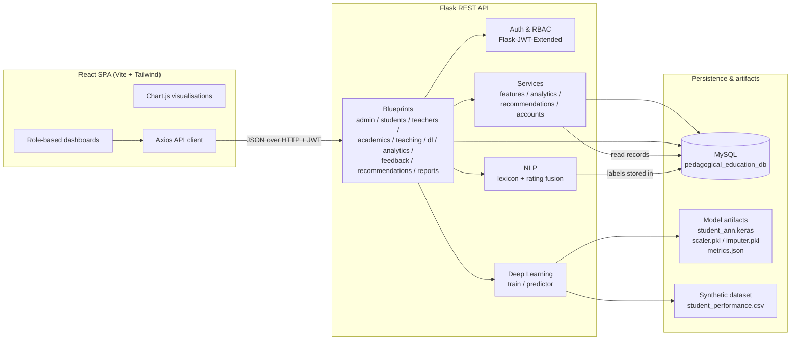
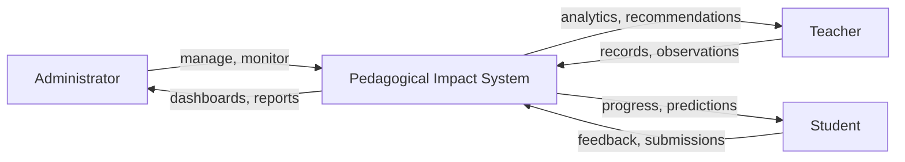
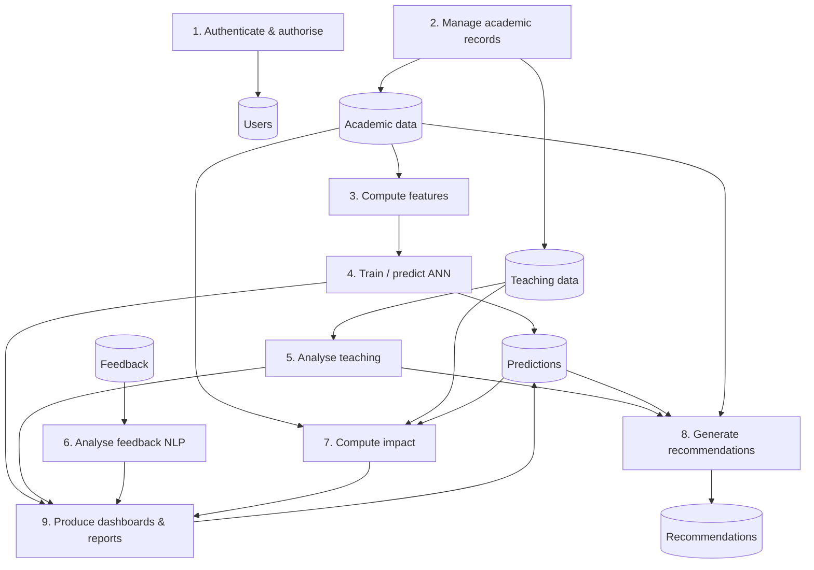
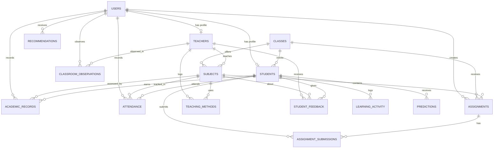
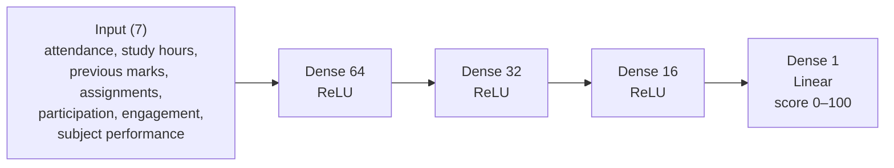

# Project Report

## Pedagogical and Educational Impact Using Deep Learning

A full-stack educational analytics platform combining a TensorFlow/Keras artificial
neural network, statistical impact analysis, lexicon-based NLP and role-based
dashboards.

---

## 1. Abstract

This project builds an end-to-end web application that studies the relationship
between teaching practice and student learning outcomes. It combines three
analytical layers: (1) a seven-feature artificial neural network that predicts a
student's academic score and flags support needs, (2) a multi-indicator teacher
analytics module that uses feedback, classroom observations and methodology logs
instead of a single effectiveness score, and (3) a pedagogical impact module that
quantifies associations between attendance, study behaviour, engagement,
assignment completion and achievement, while explicitly separating correlation
from causation.

The system is implemented with React, Vite and Tailwind CSS on the frontend,
Flask with JWT authentication and SQLAlchemy on the backend, MySQL for storage,
and TensorFlow/Keras for the neural network. Student feedback is analysed with an
explainable lexicon and rating-fusion model. Recommendations for students and
teachers are generated from transparent thresholds, and every recommendation
carries the evidence that triggered it.

The ANN is trained on a documented **synthetic** dataset of 4,000 records. On a
held-out 600-record test split it achieves MAE 3.33, MSE 17.88, RMSE 4.23 and
R² 0.66. These values describe how well the network recovers the synthetic
data-generating process; they are not evidence about real learners. The report
states this limitation wherever results are discussed.

---

## 2. Introduction

Teaching quality is usually evaluated through end-of-term ratings or aggregate
marks. Both are blunt instruments. Ratings capture perception, not learning;
marks reflect prior attainment, home support and subject difficulty as much as
teaching. Meanwhile, learning behaviour — attendance, study habits, assignment
completion, participation and engagement — is often recorded in separate systems
and never connected to instructional practice.

This project connects those data streams in one application. Teachers record
marks, attendance, assignments, learning activity, methodology and observations.
Students submit structured feedback. Administrators see institution-level
patterns. A neural network turns the behavioural record into an early-warning
score, and an impact module shows which factors co-move with achievement.

The project is deliberately cautious. It does not claim that a teaching method
causes better marks, it does not rank teachers with a fabricated composite score,
and it does not hide the fact that its training data are synthetic.

---

## 3. Problem statement

Educational institutions collect large amounts of data but use very little of it
for improvement. Specifically:

1. Student performance is reviewed only after examinations, when intervention is
   too late.
2. Teaching effectiveness is reduced to a single rating that cannot guide
   professional development.
3. Feedback is collected but rarely analysed systematically, so recurring issues
   remain invisible.
4. There is no shared view connecting teaching approach, engagement and outcomes.
5. Existing analytics tools are either commercial black boxes or static
   dashboards disconnected from the institution's database.

The problem is therefore to build a working, explainable analytics platform that
integrates these data, predicts student risk, describes teaching practice through
multiple indicators, and reports pedagogical associations without overstating
what observational data can prove.

---

## 4. Project objectives

1. Design a normalised MySQL database for students, teachers, classes, subjects,
   academic records, attendance, assignments, learning activity, teaching
   methods, classroom observations, feedback, predictions and recommendations.
2. Implement a secure Flask REST API with JWT authentication and role-based
   access control for administrators, teachers and students.
3. Train a real TensorFlow/Keras ANN with the specified architecture and report
   genuine MAE, MSE, RMSE and R² on held-out data.
4. Build a student analytics module that predicts scores, identifies support
   needs and generates personalised recommendations.
5. Build a teacher analytics module using multiple indicators and sufficient
   observations, without producing a single effectiveness score.
6. Analyse student feedback with an explainable NLP approach and protect student
   identity in summaries.
7. Build an impact module that compares methodologies, measures associations and
   clearly distinguishes correlation from causation.
8. Deliver responsive role-based dashboards in React with interactive charts.
9. Test authentication, permissions, records, deep learning, NLP, impact,
   recommendations, MySQL integration and frontend/backend integration.
10. Document the architecture, dataset, model, results, limitations and local
    Windows installation steps.

---

## 5. Existing system

Typical institutional practice has these characteristics:

| Area | Existing approach | Limitation |
|---|---|---|
| Student performance | Spreadsheets and result portals | Descriptive only; no prediction or early warning |
| Teacher evaluation | Single end-of-term rating | Not diagnostic; conflates popularity with learning |
| Feedback | Paper or generic forms | Rarely analysed; no aspect-level insight |
| Attendance | Standalone register | Not linked to outcomes or engagement |
| Reporting | Manual compilation | Slow, inconsistent, hard to compare |
| Analytics tools | Commercial dashboards | Expensive, opaque, poor fit for small institutions |

The gap is not data collection but **integration and interpretation**. Records
exist in silos, and the analytical layer that would turn them into decisions is
missing.

---

## 6. Proposed system

The proposed system is a three-role web platform with a single integrated
database and a modular analytics backend.

**Administrator**
- Manage accounts, classes and subjects.
- View institution-wide academics, attendance, engagement, sentiment and risk.
- Compare teaching methodologies and read the impact analysis.
- Monitor model metrics and manage the synthetic dataset.

**Teacher**
- View assigned students and class performance.
- Enter marks, attendance, assignments and learning activity.
- Log teaching methodologies and classroom observations.
- View student score predictions and feedback insights for their own teaching.
- Receive evidence-linked improvement recommendations.

**Student**
- View only their own marks, attendance, assignments and progress.
- See their predicted score and personalised recommendations.
- Submit structured and free-text feedback about teaching.

**Analytical components**
1. **Student performance ANN** — seven behavioural features → predicted score.
2. **Teacher effectiveness analytics** — feedback dimensions, observation
   dimensions, methodology mix, outcome context and data sufficiency.
3. **Pedagogical impact analysis** — Pearson correlations, one-way ANOVA,
   methodology comparison, engagement analysis and KMeans learning patterns.

**Design principles**
- Explainability over black-box scoring.
- Multi-indicator teacher analysis, never a single rank.
- Correlation stated as correlation.
- Privacy by role; feedback summaries are anonymised.
- Clear labelling of synthetic data.

---

## 7. System architecture



**Layer responsibilities**

| Layer | Responsibility |
|---|---|
| Presentation | Routing, role-based navigation, forms, charts, loading/error states |
| API | Validation, authentication, authorisation, serialisation, error mapping |
| Service | Feature engineering, statistics, recommendations, account creation |
| ML/NLP | Training, inference, sentiment and aspect extraction |
| Data | Relational integrity, indexes, foreign keys, persisted predictions |

**Request lifecycle**
1. Axios attaches the JWT from `localStorage`.
2. Flask-JWT-Extended verifies the token.
3. The route decorator checks the role.
4. Row-level helpers check that the user may access the specific student or
   teacher.
5. The service layer queries the database or model.
6. Errors are mapped to a consistent JSON shape.

---

## 8. Data flow diagram

### Level 0 — context



### Level 1 — main processes



---

## 9. ER diagram



### Tables

| # | Table | Key columns | Notes |
|---|---|---|---|
| 1 | `users` | `id`, `email` (unique), `role`, `is_active` | Password hash, timestamps |
| 2 | `students` | `id`, `user_id` (unique FK), `roll_number` (unique), `class_id` | One profile per user |
| 3 | `teachers` | `id`, `user_id` (unique FK), `employee_code` (unique) | Department, specialization |
| 4 | `classes` | `id`, `(name, section, academic_year)` unique | Class teacher FK |
| 5 | `subjects` | `id`, `(code, class_id)` unique, `teacher_id` | Belongs to a class |
| 6 | `academic_records` | `student_id`, `subject_id`, `exam_date` | Indexed student/subject/date |
| 7 | `attendance` | `(student_id, subject_id, date)` unique | Present/absent/late |
| 8 | `assignments` | `subject_id`, `class_id`, `due_date` | Max marks |
| 9 | `assignment_submissions` | `(assignment_id, student_id)` unique | Status + marks |
| 10 | `learning_activity` | `(student_id, date)` unique | Study, participation, engagement, completion |
| 11 | `teaching_methods` | `teacher_id`, `subject_id`, `methodology` | Session log |
| 12 | `classroom_observations` | `teacher_id`, `methodology`, 5 scores | Structured observation |
| 13 | `student_feedback` | `student_id`, `teacher_id`, 6 ratings | Sentiment + score |
| 14 | `predictions` | `student_id`, `predicted_score`, `risk_level`, `features` JSON | Model history |
| 15 | `recommendations` | `user_id`, `audience`, `category`, `rationale` | Explainable rules |

The authoritative DDL is `database/schema.sql`, generated from the SQLAlchemy
metadata for MySQL 8.0. Foreign keys use `CASCADE` where child records cannot
exist without the parent, and `SET NULL` where historical records should survive
(for example attendance keeps its subject reference optional).

---

## 10. Deep learning architecture



| Component | Setting |
|---|---|
| Framework | TensorFlow 2.21 / Keras 3 |
| Input | 7 standardised features |
| Hidden layers | 64 ReLU → 32 ReLU → 16 ReLU |
| Output | 1 linear unit, clipped to 0–100 |
| Optimizer | Adam, learning rate 0.001 |
| Loss | Mean Squared Error |
| Metric | MAE |
| Batch size | 32 |
| Max epochs | 250 |
| Early stopping | `val_loss`, patience 20, restore best weights |
| LR scheduling | `ReduceLROnPlateau`, factor 0.5, patience 8 |
| Seed | 42 |

The network is intentionally small. With 4,000 rows and seven features, a deeper
model would overfit without adding explanatory power. The three hidden layers
give enough capacity to learn non-linear interactions (for example the
attendance × engagement term in the DGP) while remaining fast on a laptop CPU.

---

## 11. Dataset description

Full detail is in [`docs/DATASET.md`](DATASET.md). Summary:

| Property | Value |
|---|---|
| Name | Synthetic Student Performance Dataset |
| Rows | 4,000 |
| Features | 7 numeric |
| Target | `final_score` (0–100) |
| Missing values | ~1.5% per feature (413 cells) |
| Seed | 42 |
| Generator | `backend/app/dataset/generate_dataset.py` |
| Synthetic | **Yes** |

**Why synthetic.** The specification requires attendance, study hours, previous
marks, assignment completion, participation, engagement and subject performance
together with a final score. Public datasets do not contain this combination.
Deriving the missing columns would be fabrication, so a fully documented DGP was
used instead.

**Demonstration cohort.** `backend/app/seed_data.py` creates 54 students, 6
teachers, 3 classes, 15 subjects, attendance for 60 days, 12 weeks of activity,
assignments, 4 exams per subject, teaching logs, observations and 162 feedback
responses. A modest methodology–outcome association is planted so comparison
charts are meaningful. It is a simulation artefact, not evidence.

---

## 12. Model training methodology

### 12.1 Preprocessing

1. Load CSV and validate all required columns.
2. Split 70/15/15 into train/validation/test with `random_state=42`.
3. Fit `SimpleImputer(strategy="median")` on **training rows only**.
4. Fit `StandardScaler` on the imputed training rows.
5. Transform validation and test with the fitted objects.
6. Persist `imputer.pkl`, `scaler.pkl`, `feature_order.json`.

Fitting on the training partition only prevents information leakage from
validation or test data.

### 12.2 Training loop

```python
model = Sequential([
    Input(shape=(7,)),
    Dense(64, activation="relu"),
    Dense(32, activation="relu"),
    Dense(16, activation="relu"),
    Dense(1, activation="linear"),
])
model.compile(optimizer=Adam(0.001), loss="mse", metrics=["mae"])
model.fit(
    X_train, y_train,
    validation_data=(X_val, y_val),
    epochs=250,
    batch_size=32,
    callbacks=[EarlyStopping(monitor="val_loss", patience=20,
                             restore_best_weights=True),
               ReduceLROnPlateau(monitor="val_loss", factor=0.5, patience=8)],
)
```

### 12.3 Reproducibility

```powershell
cd backend
.venv\Scripts\python.exe -m app.deep_learning.train_student_ann --epochs 250 --seed 42
```

Artifacts written to `backend/app/deep_learning/artifacts/`:

| File | Contents |
|---|---|
| `student_ann.keras` | Trained Keras model |
| `scaler.pkl` | Fitted StandardScaler |
| `imputer.pkl` | Fitted median imputer |
| `feature_order.json` | Exact feature order and target |
| `metrics.json` | Real metrics, history, dataset metadata |

### 12.4 Inference

`predictor.py` loads the artifacts once under a lock, imputes missing inputs with
the training median, scales them, predicts, clips to 0–100 and assigns a risk
band. The same preprocessing objects are used at training and inference time, so
there is no train/serve skew.

---

## 13. Model evaluation

Metrics are computed on the **600-row test split** that the model never saw during
training or early stopping.

| Metric | Value | Interpretation |
|---|---|---|
| MAE | **3.3309** | Predictions are about 3.3 score points away from the true value on average |
| MSE | **17.8828** | Mean squared error in score² units |
| RMSE | **4.2288** | Typical error magnitude, penalising large misses |
| R² | **0.6625** | The model explains about 66% of test-set variance |

Validation performance: MAE **3.2612**, RMSE **4.0870**.

Training ran for **84 epochs** before early stopping restored the best weights.

### 13.1 Why these values are plausible

The DGP includes irreducible noise of `N(0, 4.2)`. A model cannot beat that
noise floor, so an RMSE around 4.2 is close to the theoretical minimum. R² of
0.66 reflects a genuinely noisy target rather than a weak model.

### 13.2 What the metrics do **not** mean

- They do not show that the model will predict real students well.
- They do not show that attendance causes marks.
- They are not comparable to published results on real datasets.
- A retrain can shift the values slightly because of floating-point
  non-determinism.

### 13.3 Baseline comparison (reported honestly)

A trivial mean predictor would have RMSE equal to the target standard deviation
(roughly 10–11 points on this DGP). The ANN's RMSE of 4.23 is a substantial
improvement over that baseline, which is the correct comparison for a regression
model on synthetic data.

---

## 14. Module descriptions

### 14.1 Authentication and role management
- Passwords hashed with Werkzeug PBKDF2.
- JWT access tokens (12-hour expiry) with a `role` claim.
- `role_required` and `auth_required` decorators.
- Row-level checks: `can_access_student`, `can_access_teacher`,
  `teacher_can_edit_subject`.
- Public registration is limited to students; staff accounts require an admin.
- Inactive accounts are rejected at login and on every request.

### 14.2 Student performance module
- Feature builder aggregates attendance, activity, submissions and marks.
- Produces a completeness score and a confidence label.
- ANN prediction stored in `predictions` with the exact feature snapshot.
- Dashboard shows averages, monthly attendance, marks trend, subject breakdown,
  assignment completion and the latest prediction.
- Risk bands support early intervention.

### 14.3 Teacher effectiveness module
- **Feedback indicators**: clarity, interaction, methodology, practical,
  difficulty, overall.
- **Observation indicators**: interaction, clarity, engagement, practical
  examples, material usage.
- **Context**: methodology mix, subject performance, class attendance.
- **Data sufficiency**: at least 5 feedback responses and 3 observations before
  indicators are treated as a pattern.
- **No composite score.** Indicators are shown with benchmarks and caveats.
- Recent comments are anonymised.

### 14.4 NLP feedback module
- Lexicon of positive and negative terms with negation and intensifier rules.
- Sentence-level scoring with `tanh` normalisation to `[-1, 1]`.
- Aspect detection for clarity, interaction, methodology, practical, difficulty
  and materials.
- Fusion with numeric ratings: text 65%, ratings 35% when sentiment words exist;
  ratings alone when the comment is empty or neutral.
- Stored labels power aggregate charts.
- **Limitations**: misses sarcasm, code-mixing and implicit criticism; the
  lexicon is small; aspect detection is keyword-based.

### 14.5 Recommendation module
- Rule-based and threshold-driven.
- Student rules: attendance < 75%, assignment completion < 70%, study hours < 2,
  participation < 50%, engagement < 55%, weakest subject < 60%.
- Teacher rules: clarity/interaction/practical < 3.5, observed engagement or
  material usage < 6, narrow methodology mix, negative feedback > 30% with at
  least 5 responses.
- Every item stores a `rationale` quoting the triggering value.
- Supportive language; no punitive framing.

### 14.6 Educational impact module
- Pearson correlation between six behavioural features and average score.
- One-way ANOVA across methodology groups.
- Methodology comparison using the dominant logged method per subject.
- Engagement by methodology from classroom observations.
- KMeans (k=3) learning patterns on standardised features.
- Explicit `causality_statement` and `limitations` returned to the UI.

### 14.7 Admin dashboard
Totals, average score, attendance, engagement, risk distribution, sentiment,
methodology comparison, model metrics and dataset management.

### 14.8 Teacher dashboard
Assigned students, class performance, attendance, subject results, engagement,
methodology analysis, feedback summaries, predictions and recommendations.

### 14.9 Student dashboard
Academic overview, attendance, exam marks, assignment completion, predicted
score, progress chart, feedback submission and personalised recommendations.
Students can only access their own records.

### 14.10 Classroom log (teacher data entry)
A single teacher page with four tabs, so every record the analytics consume can
be created from the application rather than only by the seeder:

1. **Teaching sessions** — subject, methodology from the controlled taxonomy,
   date, duration and a description. The teacher's methodology mix and the
   institution's methodology comparison are recomputed from these rows.
2. **Classroom observations** — five 0–10 scores (interaction, clarity,
   engagement, practical examples, material usage), methodology, date and
   observer notes. These feed the observation indicators and the engagement
   analysis.
3. **Assignments** — subject, title, instructions, due date and maximum marks.
   The assignment is created for every student in the subject's class, and
   students can then submit it.
4. **Learning activity** — study hours, participation, engagement and
   assignment completion for one student on one date (upsert).

Ownership is enforced server-side: a teacher can only write against their own
teacher id and their own subjects, and only for students they are entitled to
see. Methodology values are validated against the six-value taxonomy, so the
comparison charts cannot fill up with free-text variants such as "lecture
(sort of)".

---

## 15. Results and limitations

### 15.1 Functional results

| Requirement | Status | Evidence |
|---|---|---|
| Three roles with RBAC | Done | 403 tests for cross-role access |
| Student performance prediction | Done | Live prediction returned 71.72 (low risk) |
| Required ANN architecture | Done | 7 → 64 → 32 → 16 → 1 |
| Real metrics | Done | MAE 3.3309, MSE 17.8828, RMSE 4.2288, R² 0.6625 |
| Teacher multi-indicator analytics | Done | 7 indicators + sufficiency + caveats |
| Teaching sessions & observations entry | Done | `POST /api/teaching/sessions`, `POST /api/teaching/observations` + Classroom log UI |
| NLP feedback analysis | Done | Lexicon + rating fusion, aspect scores |
| Impact with correlation/causation | Done | Pearson r, ANOVA, explicit statement |
| Explainable recommendations | Done | Every item has a rationale |
| MySQL integration | Done | Live schema and 15 tables |
| Automated tests | Done | 20 passed, 1 optional MySQL test |
| Frontend build | Done | Vite production build succeeds |

### 15.2 Demonstration data snapshot

- 54 students, 6 teachers, 3 classes, 15 subjects.
- 54 stored predictions, 162 feedback responses.
- Institution average score ≈ 63.6%.
- Student 1001: average 61.0%, attendance 93.18%.

### 15.3 Limitations

1. **Synthetic training data.** The ANN learns a simulation, not real learners.
2. **Synthetic demonstration cohort.** Dashboard patterns are planted by design.
3. **No causal design.** Methodology comparisons are observational and
   confounded by teacher, subject and class composition.
4. **Lexicon NLP.** Sarcasm, Hinglish and implicit criticism are missed.
5. **Small cohort.** 54 students cannot support generalisable conclusions.
6. **Self-report.** Study hours and engagement would be self-reported in reality.
7. **No external validation.** The model has not been tested on a real
   institution's records.
8. **No model fairness audit.** Subgroup performance (gender, income, language)
   cannot be assessed because the synthetic data do not contain those attributes.
9. **Single-node deployment.** The development server is not production-grade.

### 15.4 Threats to validity

- **Internal validity:** planted methodology effects and omitted confounders.
- **External validity:** synthetic distributions may not match any real cohort.
- **Construct validity:** "engagement" and "teacher quality" are simulation
  parameters, not validated instruments.
- **Conclusion validity:** multiple correlations increase false-positive risk;
  p-values are reported for transparency, not as proof.

---

## 16. Future enhancements

1. Replace the synthetic dataset with a consented, anonymised institutional
   dataset and re-train with proper cross-validation.
2. Add temporal models (LSTM/GRU) once multi-term sequences are available.
3. Add fairness evaluation across demographic subgroups and mitigate disparities.
4. Replace the lexicon with a fine-tuned transformer, keeping an explainable
   fallback for offline use.
5. Add propensity-score or multilevel models to strengthen causal inference.
6. Add intervention tracking to measure whether recommendations change outcomes.
7. Add scheduled retraining, model registry and drift monitoring.
8. Add PDF export and email delivery for reports.
9. Add audit logs for sensitive record access.
10. Containerise with Docker and deploy behind a production WSGI server.

---

## 17. Installation instructions (Windows)

### 17.1 Prerequisites

| Tool | Version used | Check |
|---|---|---|
| Python | 3.13.2 | `python --version` |
| Node.js | 22.13.1 | `node --version` |
| npm | 10.9.2 | `npm --version` |
| MySQL | 8.0.41 | `mysql --version` |

### 17.2 Database

```powershell
mysql -u root -p -e "CREATE DATABASE IF NOT EXISTS pedagogical_education_db CHARACTER SET utf8mb4 COLLATE utf8mb4_unicode_ci;"
mysql -u root -p pedagogical_education_db < database\schema.sql
```

### 17.3 Backend

```powershell
cd F:\EDUCATION2\backend
python -m venv .venv
.venv\Scripts\Activate.ps1
pip install -r requirements.txt
copy .env.example .env
# edit .env and set DB_PASSWORD and the JWT/SECRET keys
```

If TensorFlow is already installed system-wide and you want to reuse it:

```powershell
python -m venv --system-site-packages .venv
```

Create tables and demo data:

```powershell
.venv\Scripts\python.exe -m app.seed_data --reset
```

This also trains the ANN and stores predictions and recommendations. To train
separately:

```powershell
.venv\Scripts\python.exe -m app.deep_learning.train_student_ann
```

Run the API:

```powershell
.venv\Scripts\python.exe run.py
```

API: `http://127.0.0.1:5000` · health: `http://127.0.0.1:5000/api/health`

### 17.4 Frontend

```powershell
cd F:\EDUCATION2\frontend
npm install
npm run dev
```

Open `http://localhost:5173`.

Production build:

```powershell
npm run build
npm run preview
```

### 17.5 Demo accounts

| Role | Email | Password |
|---|---|---|
| Admin | `admin@school.edu` | `Admin@12345` |
| Teacher | `teacher1@school.edu` | `Teacher@12345` |
| Student | `student1001@school.edu` | `Student@12345` |

### 17.6 Tests

```powershell
cd F:\EDUCATION2\backend
.venv\Scripts\python.exe -m pytest tests -q

# live MySQL check (optional)
$env:TEST_MYSQL="1"
.venv\Scripts\python.exe -m pytest tests\test_mysql_integration.py -q
```

### 17.7 Troubleshooting

| Symptom | Fix |
|---|---|
| `Access denied for user 'root'` | Set the correct `DB_PASSWORD` in `backend/.env` |
| `Model not trained` (503) | Run the training command or click **Train / retrain model** |
| TensorFlow GPU warning | Harmless on native Windows; CPU is used |
| CORS error | Add the frontend origin to `CORS_ORIGINS` in `.env` |
| Port 5000 in use | Stop the other process or change the port in `run.py` |
| `h5py`/`rich` import errors | `pip install "h5py>=3.11,<3.15" rich wrapt requests markdown` |

---

## 18. Testing

The automated suite uses an in-memory SQLite database for speed; the MySQL
integration test runs against the real database when `TEST_MYSQL=1`.

| # | Test | File |
|---|---|---|
| 1 | Admin authentication | `tests/test_api.py::test_admin_login` |
| 2 | Teacher authentication | `test_teacher_and_student_login` |
| 3 | Student authentication | `test_teacher_and_student_login` |
| 4 | Role-based permissions | `test_role_based_permissions` |
| 5 | Student record management | `test_admin_creates_student_and_teacher` |
| 6 | Teacher record management | `test_admin_creates_student_and_teacher` |
| 7 | Attendance and marks | `test_teacher_enters_marks_only_for_own_subject`, `test_attendance_bulk_and_marks_validation` |
| 8 | Deep learning training | `test_ann_training_metrics_are_real` |
| 9 | Score prediction | `test_prediction_endpoint` |
| 10 | Teacher analytics | `test_teacher_analytics_and_reports` |
| 11 | Feedback submission | `test_student_feedback_submission_and_privacy` |
| 12 | NLP analysis | `test_nlp_analyzer_labels_and_aspects` |
| 13 | Impact visualisation data | `test_impact_analysis_and_methodology_comparison` |
| 14 | Recommendations | `test_recommendations_are_explainable` |
| 15 | MySQL integration | `tests/test_mysql_integration.py` |
| 16 | Frontend/backend integration | Live smoke test against port 5000 + `npm run build` |
| 17 | Teaching session & observation entry | `test_teacher_logs_session_and_observation` |
| 18 | Teaching record ownership | `test_teaching_records_respect_ownership` |

Result at the time of writing: **20 passed, 1 skipped** (the MySQL test is skipped
unless `TEST_MYSQL=1`); with the flag it passes against MySQL 8.0.

---

## 19. Conclusion

The project delivers a working, integrated platform rather than a mock-up. A real
Keras network is trained and served, a normalised MySQL schema stores all
required entities, JWT and role checks protect every route, and the React
frontend consumes the live API. Teacher analytics are deliberately
multi-indicator, recommendations are explainable, and the impact module states
plainly that its findings are associations.

The honest limitation is the data. Synthetic records make the application
demonstrable and reproducible, but they cannot support claims about real
teaching. The correct next step is a consented institutional dataset and a
stronger research design; the software is structured to accept both.

---

## References

1. Cortez, P., & Silva, A. (2008). *Using Data Mining to Predict Secondary School
   Student Performance.* University of Minho.
2. Kingma, D. P., & Ba, J. (2015). *Adam: A Method for Stochastic Optimization.*
   ICLR.
3. Srivastava, N., Hinton, G., Krizhevsky, A., Sutskever, I., & Salakhutdinov, R.
   (2014). *Dropout: A Simple Way to Prevent Neural Networks from Overfitting.*
   JMLR.
4. TensorFlow/Keras documentation — https://www.tensorflow.org/
5. Flask documentation — https://flask.palletsprojects.com/
6. Flask-JWT-Extended documentation —
   https://flask-jwt-extended.readthedocs.io/
7. scikit-learn documentation — https://scikit-learn.org/
8. Chart.js documentation — https://www.chartjs.org/
